# CloudDevOpsProject – iVolve / NTI Final Project

End-to-end DevOps project for a 3-tier microservices web app (user sign-up / login + DevOps roadmap):
containerization, infrastructure as code, configuration management, Kubernetes, CI with Jenkins
and GitOps CD with Argo CD.

| Area | Tooling | Location |
|---|---|---|
| Source code | Node.js, Python Flask, Java Spring Boot, MySQL | `frontend/`, `auth-service/`, `roadmap-service/` |
| Local build & test | Docker, Docker Compose | `docker-compose.yml`, `.env.example` |
| Infrastructure | Terraform (S3 remote state) – VPC, EC2, EKS, ECR | `terraform/` |
| Configuration | Ansible roles + AWS dynamic inventory | `ansible/` |
| Orchestration | Kubernetes + Kustomize | `k8s/` |
| CI | Jenkins pipelines + shared library | `*/Jenkinsfile`, `vars/` |
| CD | Argo CD (GitOps) | `argocd/` |
| Documentation | this README + `docs/` | `docs/` |

---

## 1. Architecture overview

### Application

```text
 Browser ──HTTP──► Ingress (nginx, host ivolve.local)
                        │
                        ▼
                 frontend  (Node.js/Express, :3000)  ── Deployment x2 + Service
                   │                     │
                   ▼                     ▼
        auth-service (Flask, :5000)   roadmap-service (Spring Boot, :8080)
        Deployment x2 + Service       Deployment x2 + Service
                   │
                   ▼
        MySQL 8.4 StatefulSet (mysql-0)  ◄── headless Service mysql-headless
                   │
                   ▼
        PersistentVolume (StorageClass ivolve-mysql-sc)
```

Configuration comes from the `ivolve-config` ConfigMap (hosts, ports, DB name) and the
`ivolve-secret` Secret (DB user/password, root password, session secret).

### Delivery pipeline (GitOps)

```text
 developer ──git push──► GitHub (CloudDevOpsProject)
                             │
                             ▼
 Jenkins (agent "slave") ── per microservice pipeline, shared library vars/
   1 Build Image          docker build
   2 Scan Image           trivy (HIGH, CRITICAL)
   3 Push Image           registry (ECR on AWS / minikube registry locally)
   4 Delete Image Locally docker rmi
   5 Update Manifests     new tag in k8s/overlays/<env>/kustomization.yaml
   6 Push Manifests       git commit "[skip ci]" + push ──► GitHub
                                                              │
                         Argo CD (auto-sync, prune, self-heal) ◄┘
                                     │
                                     ▼
                          Kubernetes namespace "ivolve"
```

### AWS infrastructure (Terraform)

```text
 VPC 10.0.0.0/16  (region us-east-1, 2 AZs)
 ├── public subnets  10.0.1.0/24, 10.0.2.0/24   ── IGW, NACL
 │     ├── NAT gateway (+ Elastic IP)
 │     └── Jenkins EC2 (t3.medium, SG: 22/8080 from admin CIDR, IAM role: ECR push + EKS)
 └── private subnets 10.0.11.0/24, 10.0.12.0/24 ── route via NAT, NACL
       └── EKS cluster  ── node group 1 (AZ a, 1 node) + node group 2 (AZ b, 1 node)
                           addon aws-ebs-csi-driver (volumes for MySQL)
 ECR: clouddevops/frontend, clouddevops/auth-service, clouddevops/roadmap-service
 S3:  clouddevops-tfstate-toqaosama  (Terraform remote state, native S3 locking)
```

More detail: [docs/architecture.md](docs/architecture.md).

**Repository on GitHub:**

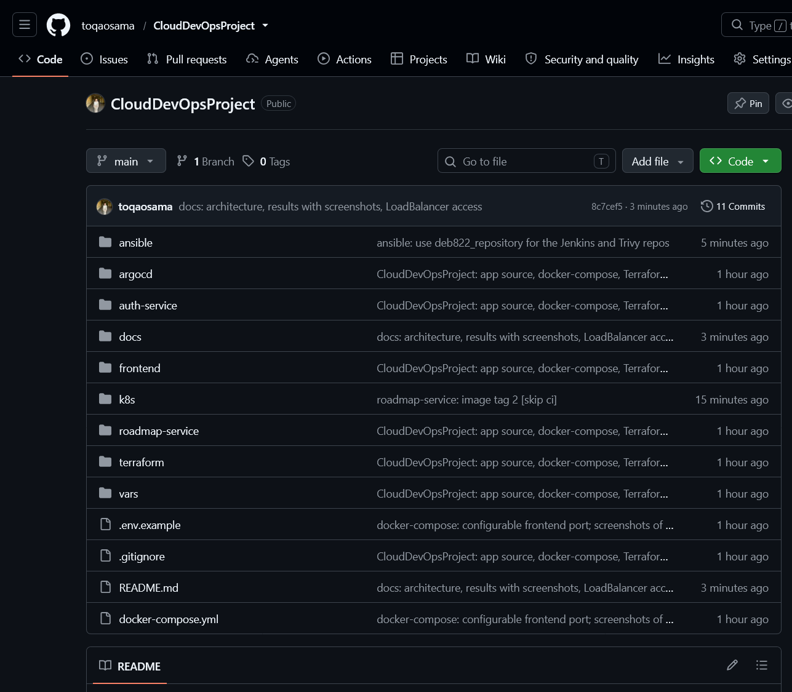

---

## 2. Repository structure

```text
.
├── frontend/              Node.js UI + Dockerfile + Jenkinsfile
├── auth-service/          Flask auth API + Dockerfile + Jenkinsfile
├── roadmap-service/       Spring Boot API + Dockerfile + Jenkinsfile
├── docker-compose.yml     local build & test with MySQL
├── .env.example           variables for docker compose
├── terraform/
│   ├── bootstrap/         S3 bucket for the remote state (run once)
│   ├── backend.tf         S3 backend
│   ├── main.tf            calls the modules
│   └── modules/
│       ├── network/       VPC, public/private subnets, IGW, NAT, route tables, NACLs
│       ├── server/        Jenkins EC2, security group, IAM role/profile
│       ├── eks/           EKS cluster, 2 node groups in 2 private subnets/AZs, EBS CSI addon
│       └── ecr/           one repository per microservice
├── ansible/
│   ├── inventory/aws_ec2.yml   dynamic inventory (tag role=jenkins)
│   ├── playbook.yml
│   └── roles/             java, docker, trivy, jenkins
├── k8s/
│   ├── base/              namespace, StorageClass, ConfigMap, Secret, MySQL StatefulSet +
│   │                      headless service, 3 Deployments + Services, Ingress
│   └── overlays/
│       ├── local/         minikube (registry addon images, hostpath storage)
│       └── eks/           EKS (ECR images, EBS storage)
├── vars/                  Jenkins shared library (one step per stage)
├── argocd/                Argo CD Application (local + EKS)
└── docs/                  architecture notes and screenshots
```

---

## 3. Setup instructions

### Prerequisites

Docker, kubectl, Terraform >= 1.10, Ansible (+ `amazon.aws` collection, `boto3`), AWS CLI,
a Jenkins controller, and minikube (local) or the EKS cluster (AWS).

### 3.1 Run locally with Docker Compose

```bash
cp .env.example .env          # set your own passwords
docker compose up -d --build
docker compose ps             # all services running, auth-service and mysql healthy
```

Open http://localhost:3000, create an account, log in and see the roadmap page.

All containers up, sign-up / login / roadmap work, the user is saved in MySQL (bcrypt hash):

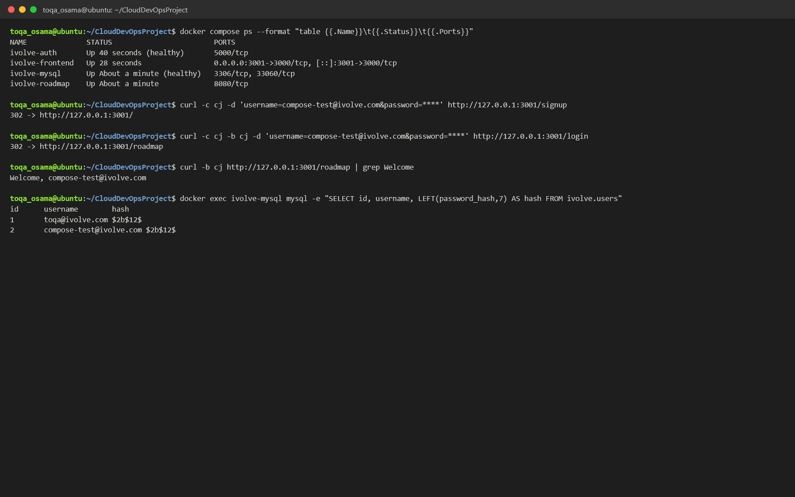

| Login page | Roadmap page after login |
|---|---|
| 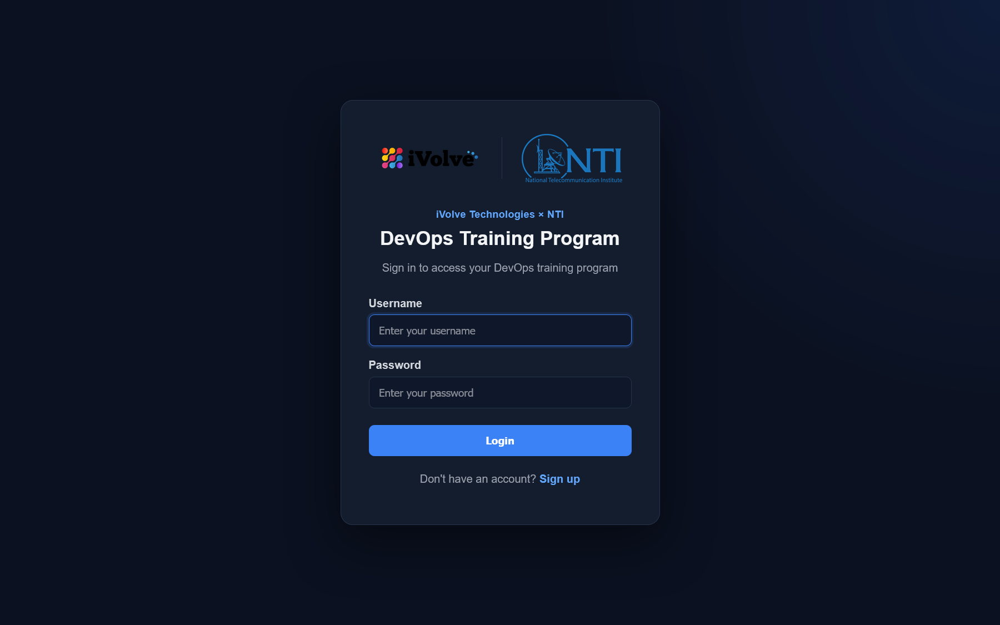 | 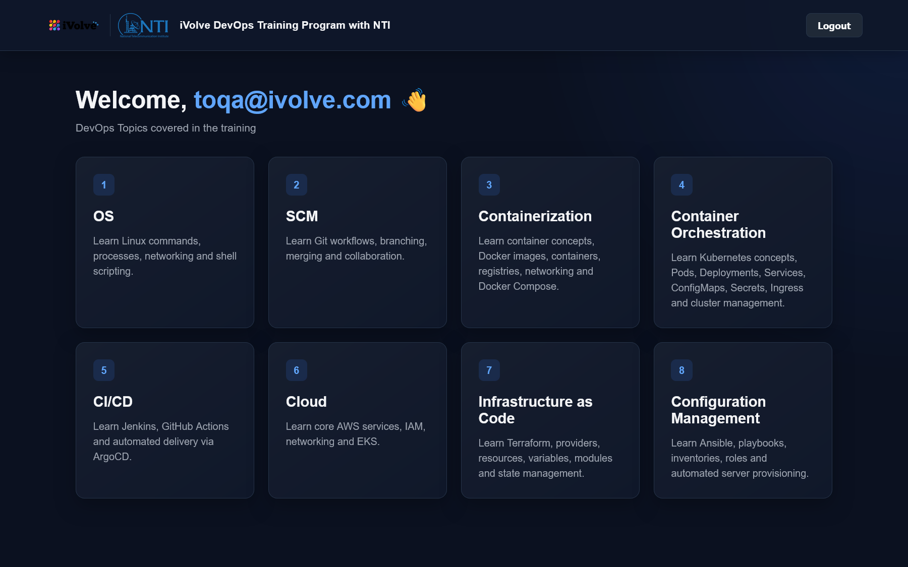 |

### 3.2 Provision AWS with Terraform

```bash
# one time: S3 bucket for the state
cd terraform/bootstrap
terraform init && terraform apply

# main stack
cd ..
cp terraform.tfvars.example terraform.tfvars   # key_name, admin_cidr
terraform init                                 # uses the S3 backend
terraform plan
terraform apply
terraform output                               # jenkins_url, ecr_repository_urls, eks_update_kubeconfig
aws eks update-kubeconfig --region us-east-1 --name clouddevops-eks
```

Destroy everything afterwards: `terraform destroy` (EKS, NAT and EC2 cost money while running).

`fmt`, `init` and `validate` pass for the main stack and the bootstrap:

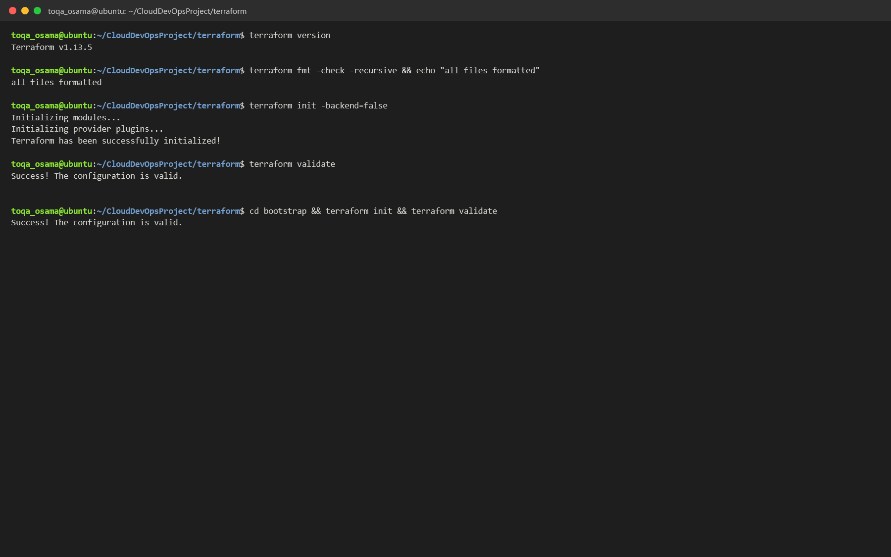

### 3.3 Configure the Jenkins server with Ansible

```bash
cd ansible
ansible-galaxy collection install -r requirements.yml
pip install boto3 botocore
ansible-inventory --graph          # finds the EC2 by tag role=jenkins
ansible-playbook playbook.yml      # java, docker, trivy, jenkins
```

Dynamic inventory, roles and playbook (syntax check + task list):

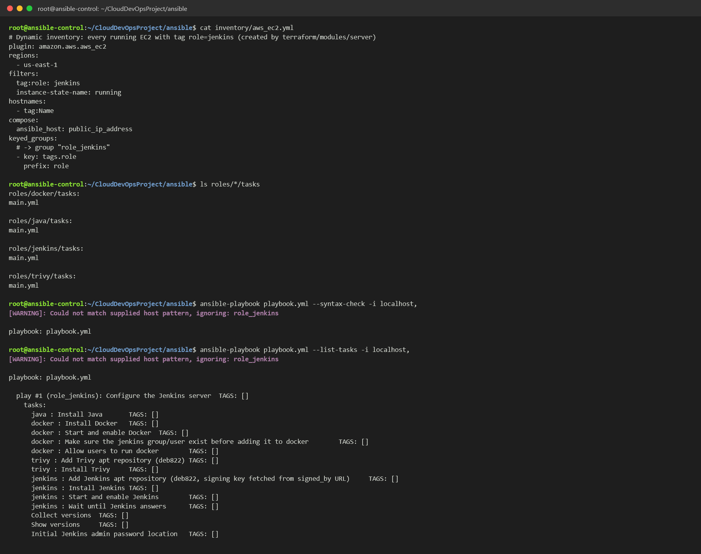

### 3.4 Kubernetes

Local (minikube):

```bash
minikube start
minikube addons enable ingress
minikube addons enable registry        # images are pushed to localhost:5000
kubectl apply -k k8s/overlays/local    # or let Argo CD do it (3.6)
```

EKS: install the NGINX ingress controller, replace `<ACCOUNT_ID>` in `k8s/overlays/eks/kustomization.yaml`,
then use `argocd/application-eks.yaml`.

All resources running in namespace `ivolve` (Deployments, StatefulSet + PVC, StorageClass, Services,
headless service, LoadBalancer, Ingress, ConfigMap, Secret):

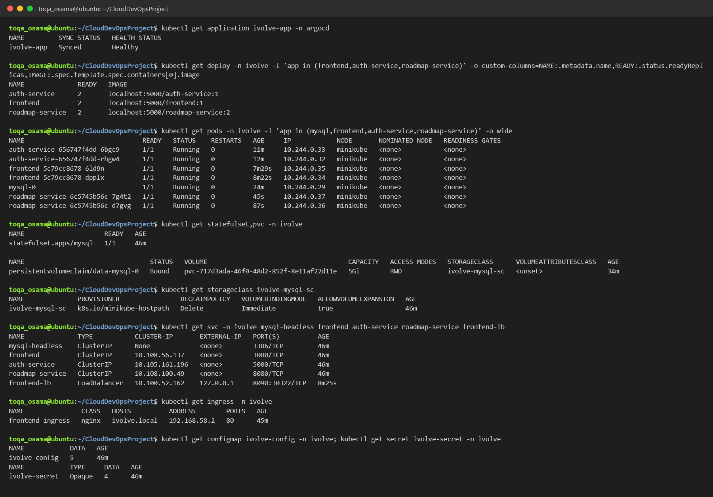

### 3.5 Jenkins

1. Credentials: `github` (username + GitHub token with `repo` scope) for the *Push Manifests* stage.
   On AWS the EC2 IAM role is used for ECR (no stored keys).
2. **Manage Jenkins → System → Global Trusted Pipeline Libraries**: name `ivolve-final-lib`,
   default version `main`, Git `https://github.com/toqaosama/CloudDevOpsProject.git` (library = `vars/` at the repo root).
3. An agent with label `slave` that has Docker, Trivy and Git.
4. One pipeline job per microservice, *Pipeline script from SCM*, script path
   `frontend/Jenkinsfile`, `auth-service/Jenkinsfile`, `roadmap-service/Jenkinsfile`.

Shared library steps (`vars/`):

| Step | Stage |
|---|---|
| `buildImage` | Build Image |
| `scanImage` | Scan Image (Trivy) |
| `pushImage` | Push Image (local registry, Docker Hub credential or ECR) |
| `deleteImageLocally` | Delete Image Locally |
| `updateManifests` | Update Manifests (new tag in the kustomize overlay) |
| `pushManifests` | Push Manifests (commit + push with retry/rebase) |

The 3 pipelines in Jenkins:

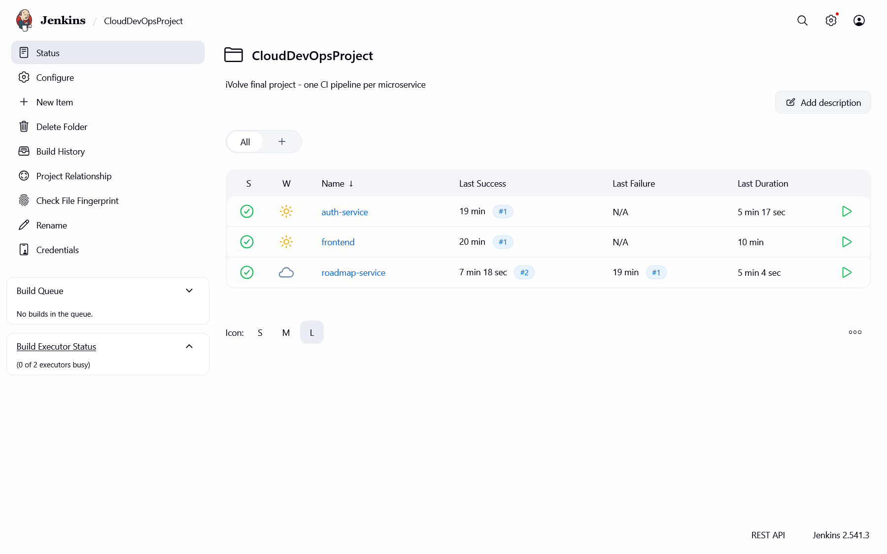

**frontend** – all 6 stages on the `slave` agent:

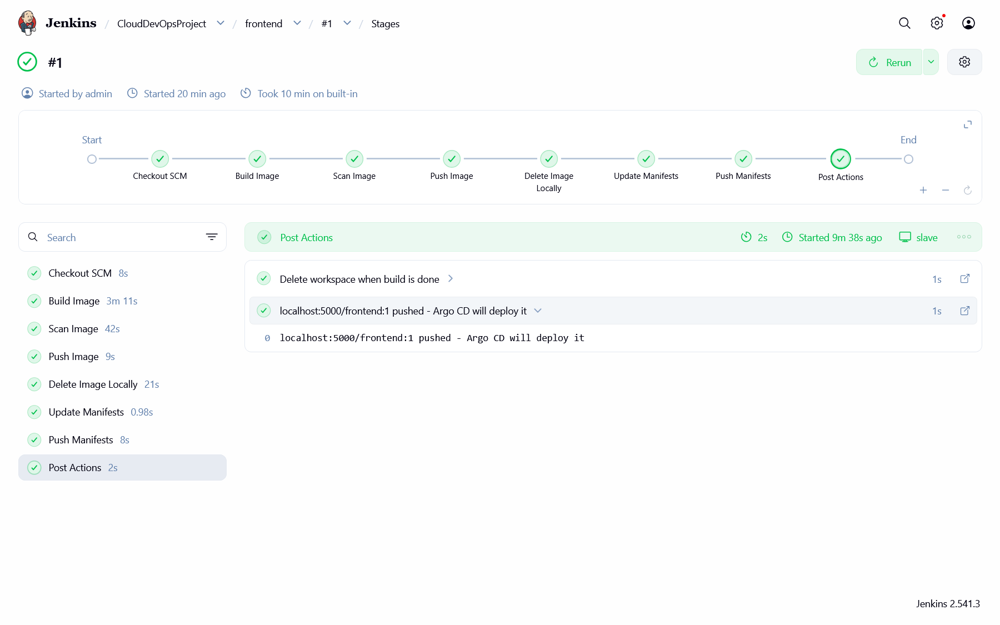

**auth-service:**

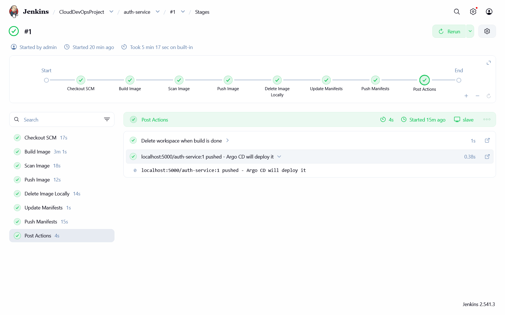

**roadmap-service:**

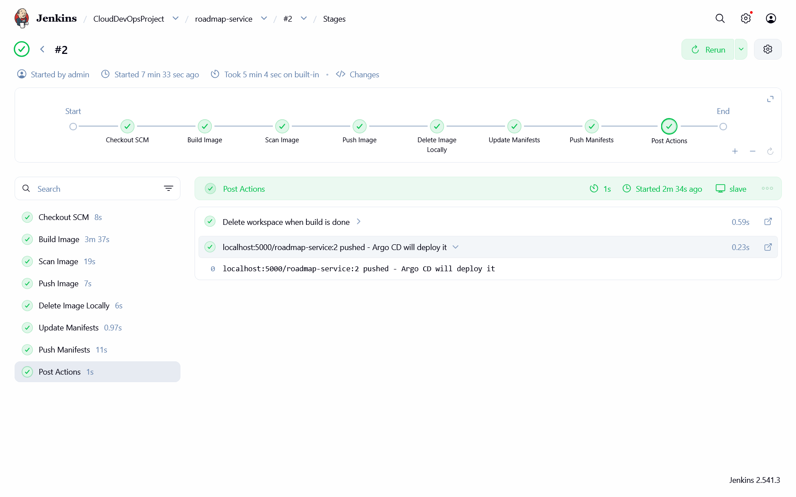

*Push Manifests* commits the new image tags to GitHub as user `jenkins`:

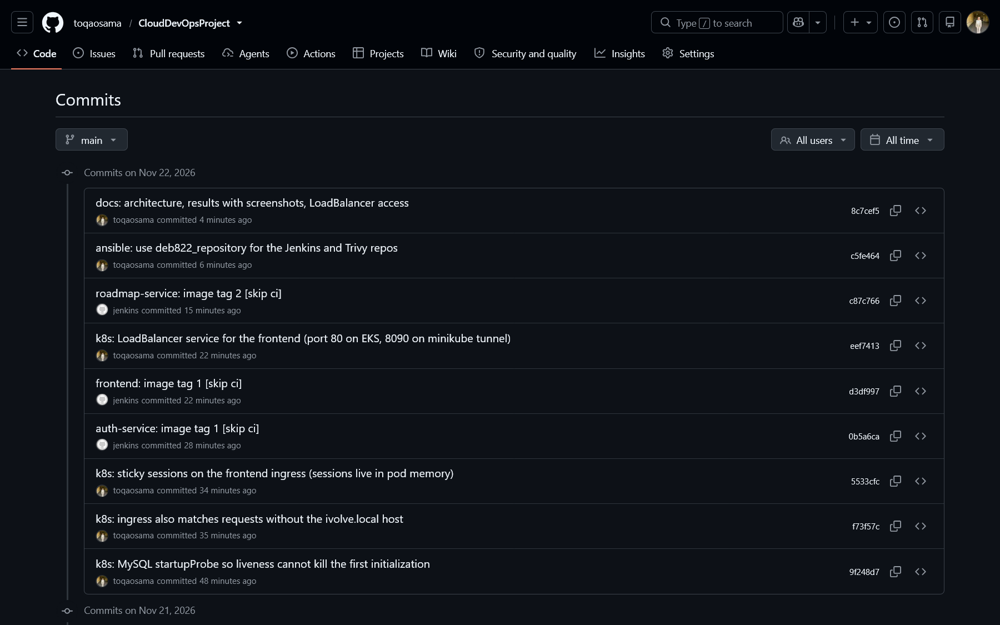

### 3.6 Argo CD

```bash
kubectl create namespace argocd
kubectl apply -n argocd --server-side -f https://raw.githubusercontent.com/argoproj/argo-cd/stable/manifests/install.yaml
kubectl apply -f argocd/application.yaml
kubectl get application ivolve-app -n argocd    # Synced / Healthy
```

After every pipeline run, Argo CD picks up the new tag from Git and rolls out the new image.
The application is **Synced** to the last Jenkins commit and **Healthy**:

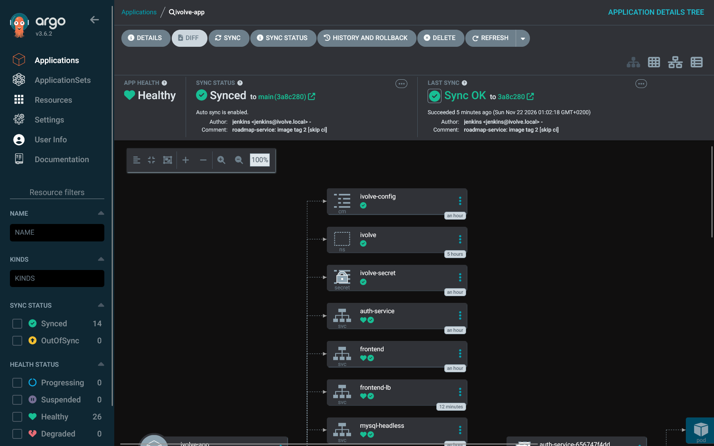

---

### 3.7 Test access through the LoadBalancer

```bash
minikube tunnel                              # gives frontend-lb an external IP (127.0.0.1 locally)
kubectl get svc frontend-lb -n ivolve        # EXTERNAL-IP / PORT(S)
# open http://127.0.0.1:8090  (on EKS: http://<NLB DNS name>)
```

| Login through the LoadBalancer | Roadmap page after login |
|---|---|
|  |  |

### 3.8 Watching the pipelines

Jenkins ships with **Pipeline Graph View** (the *Stages* page of every build). For a wall dashboard of all
jobs, install the **Build Monitor View** plugin.

---

## 4. Results

Everything above was run for real on a local environment (Docker Desktop + minikube, Jenkins with a Docker
agent, Argo CD). The AWS part (Terraform, Ansible dynamic inventory) is delivered as validated code and was not
applied, to avoid cloud cost.

All screenshots and the problems fixed during the runs: [docs/results.md](docs/results.md).
