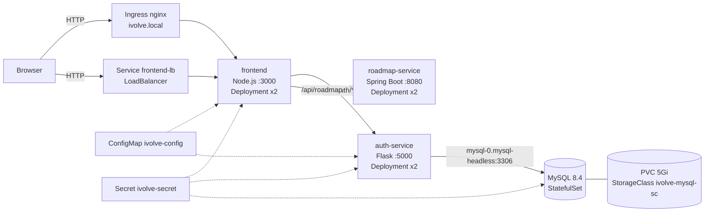
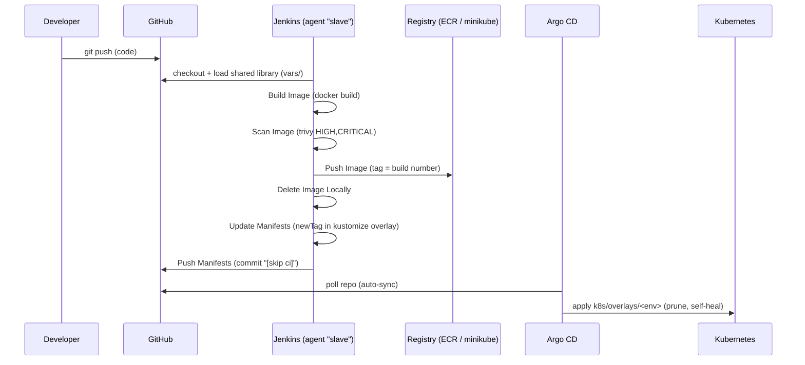
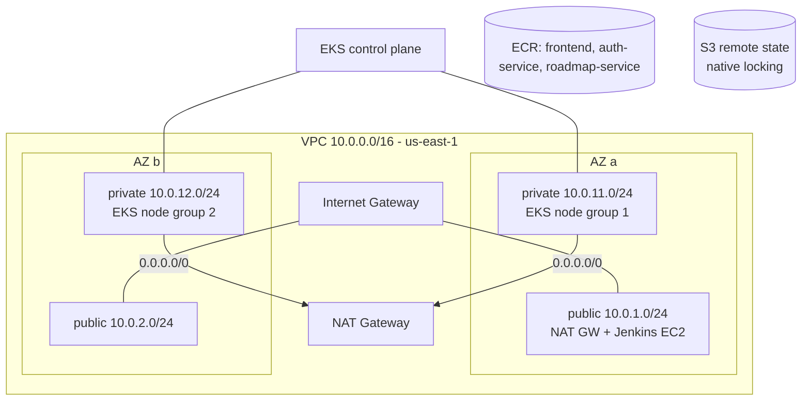

# Architecture

## 1. Application

| Component | Kind | Port | Config |
|---|---|---|---|
| frontend | Deployment (2) + ClusterIP + Ingress + LoadBalancer | 3000 | AUTH_SERVICE_URL, ROADMAP_SERVICE_URL (ConfigMap), SESSION_SECRET (Secret) |
| auth-service | Deployment (2) + ClusterIP | 5000 | DB_HOST/PORT/NAME (ConfigMap), DB_USER/PASSWORD (Secret) |
| roadmap-service | Deployment (2) + ClusterIP | 8080 | – |
| mysql | StatefulSet (1) + headless service | 3306 | MYSQL_ROOT_PASSWORD, MYSQL_USER, MYSQL_PASSWORD (Secret), MYSQL_DATABASE (ConfigMap) |

Probes: readiness on HTTP endpoints (`/health`, `/api/roadmap`, `/`), liveness on TCP / `mysqladmin ping`,
startupProbe for MySQL so the first initialization is never interrupted.

## 2. CI/CD (GitOps)

## 3. AWS infrastructure (Terraform)

| Module | Resources |
|---|---|
| `network` | VPC, 2 public + 2 private subnets (2 AZs), IGW, NAT GW + EIP, route tables, public/private NACLs, EKS subnet tags |
| `server` | Jenkins EC2 (Ubuntu 24.04, gp3 encrypted, IMDSv2), security group (22/8080 from admin CIDR), IAM role + instance profile (ECR push, EKS describe), tag `role=jenkins` for Ansible |
| `eks` | cluster role, EKS cluster in the private subnets, node role, **one node group per private subnet** (2 nodes in 2 AZs), EBS CSI addon, access entry for the Jenkins role |
| `ecr` | one repository per microservice, scan on push, lifecycle policy (keep 10) |
| backend | S3 bucket from `terraform/bootstrap` (versioning, encryption, public access block), `use_lockfile = true` |

## 4. Environments (Kustomize)

| Overlay | Images | StorageClass | Used by |
|---|---|---|---|
| `k8s/overlays/local` | `localhost:5000/<service>` (minikube registry addon) | `k8s.io/minikube-hostpath` | `argocd/application.yaml` |
| `k8s/overlays/eks` | `<account>.dkr.ecr.us-east-1.amazonaws.com/clouddevops/<service>` | `ebs.csi.aws.com` gp3 | `argocd/application-eks.yaml` |
