# Results – proof that every part works

All screenshots come from real runs (local environment: Docker Desktop + minikube, Jenkins with a
Docker agent labelled `slave`, Argo CD in the cluster). AWS resources are delivered as validated
Terraform/Ansible code (`terraform validate`, `ansible-playbook --syntax-check`), not applied, to avoid cost.

## 1. GitHub repository

https://github.com/toqaosama/CloudDevOpsProject

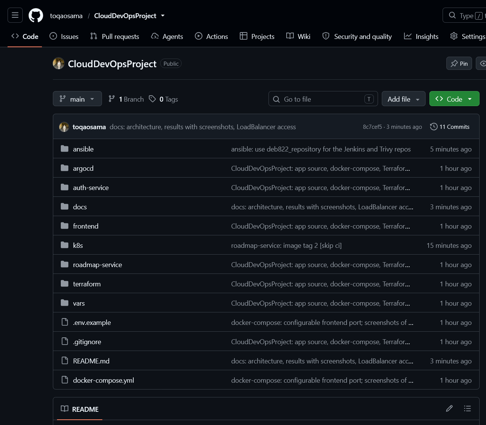

## 2. Docker Compose – app + MySQL locally

`docker compose up -d --build` → all services up, MySQL and auth-service healthy. Sign-up, login and the
roadmap page work, and the user is stored in MySQL with a bcrypt hash:

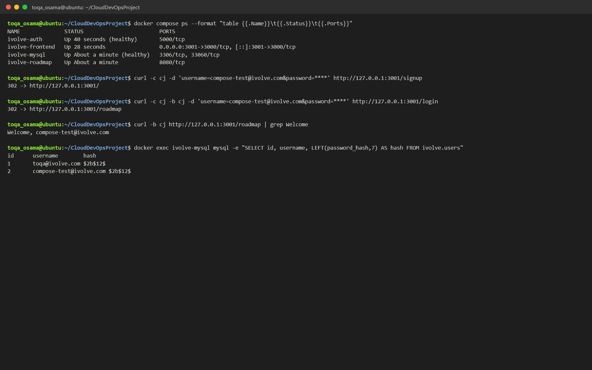

| Login page | Roadmap page after login |
|---|---|
| 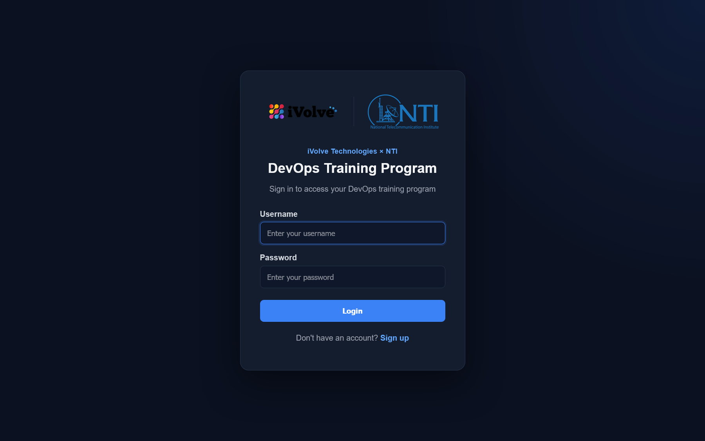 | 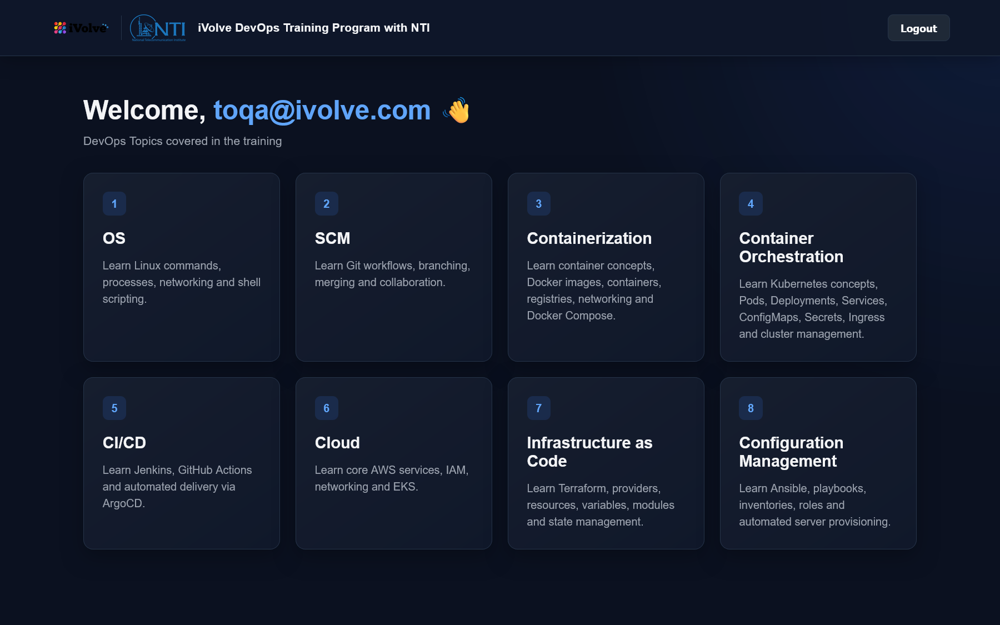 |

## 3. Terraform

`terraform fmt -check`, `init -backend=false` and `validate` succeed for the main stack
(network, server, eks, ecr modules) and for the S3 state bootstrap:

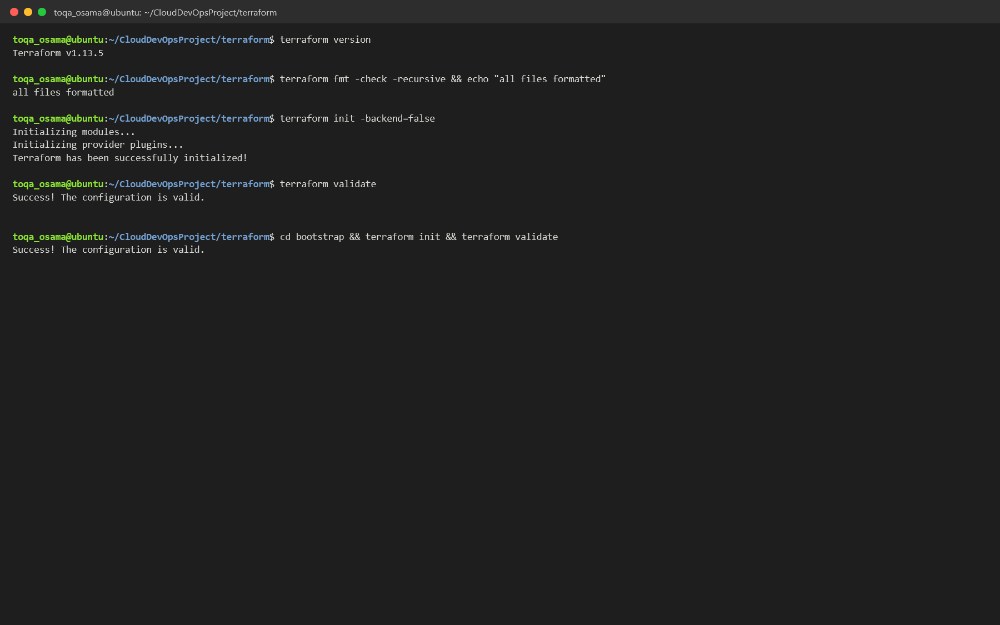

## 4. Ansible

Dynamic inventory (`amazon.aws.aws_ec2`, tag `role=jenkins`), 4 roles, playbook passes the syntax check:

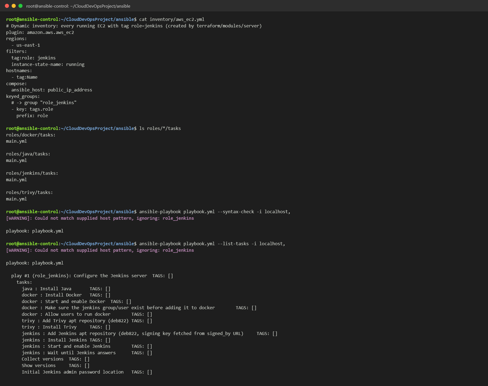

## 5. Kubernetes

Namespace `ivolve`: 3 Deployments (2 replicas each) + Services, MySQL StatefulSet with headless service and
a PVC from the `ivolve-mysql-sc` StorageClass, ConfigMap, Secret, Ingress and a LoadBalancer service:

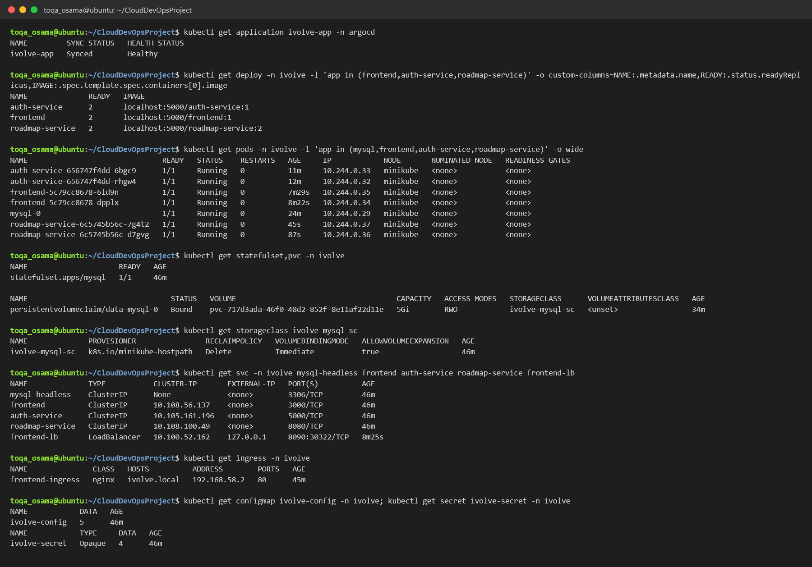

Access through the **LoadBalancer** service `frontend-lb` (minikube tunnel → `127.0.0.1:8090`):

| Login page | Roadmap page after login |
|---|---|
|  |  |

## 6. Jenkins CI (shared library)

Folder `CloudDevOpsProject` with one pipeline per microservice:

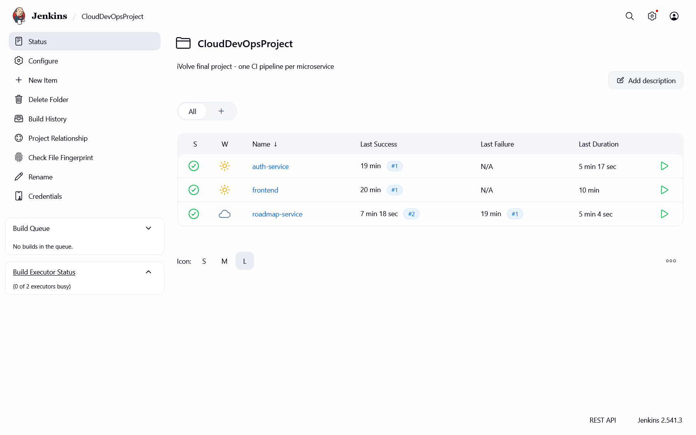

Every pipeline runs on the `slave` agent with the 6 stages from the shared library (`vars/`):
Build Image → Scan Image → Push Image → Delete Image Locally → Update Manifests → Push Manifests.

**frontend #1**

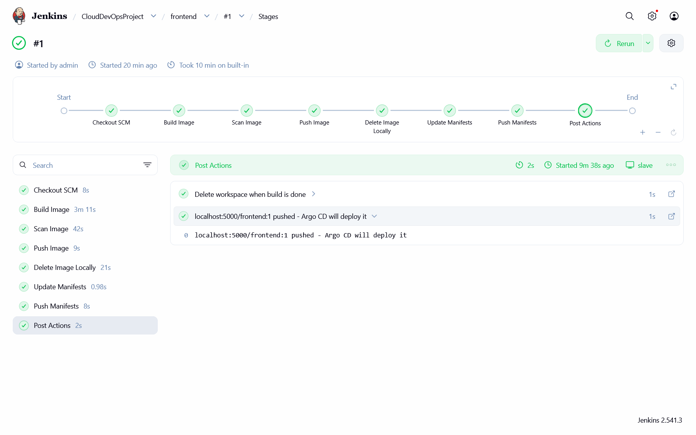

**auth-service #1**

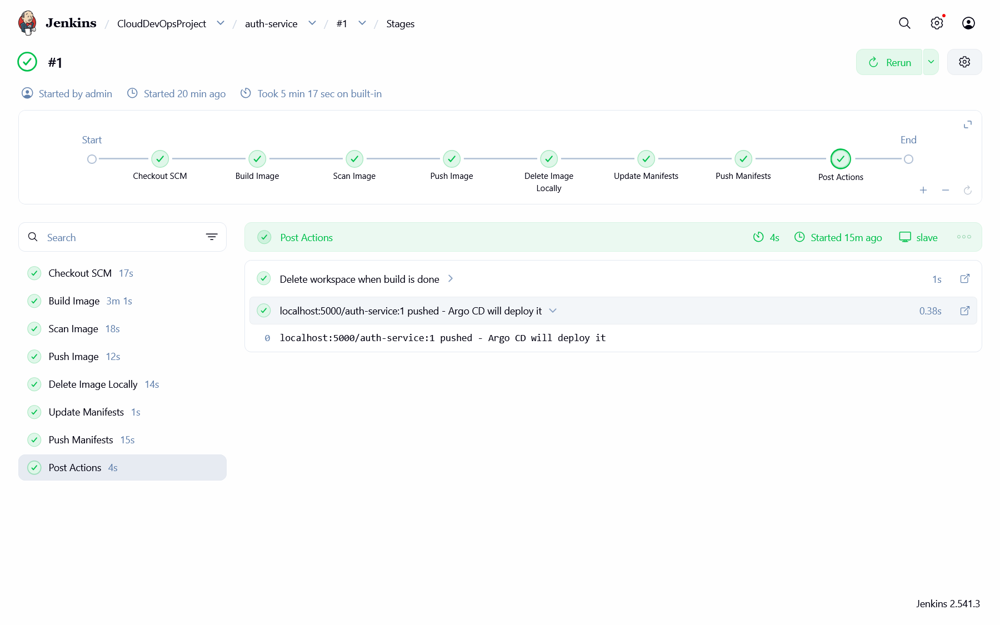

**roadmap-service #2**

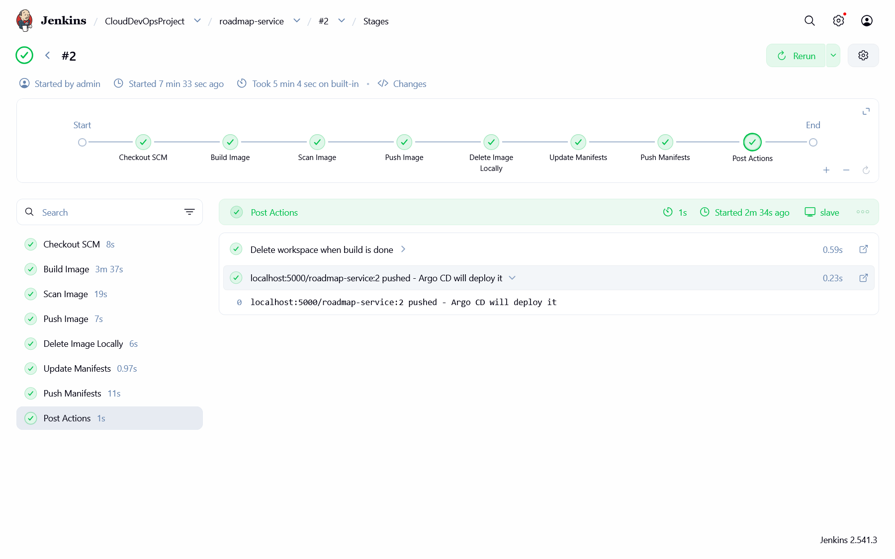

The *Push Manifests* stage commits the new image tag to GitHub as user `jenkins`:

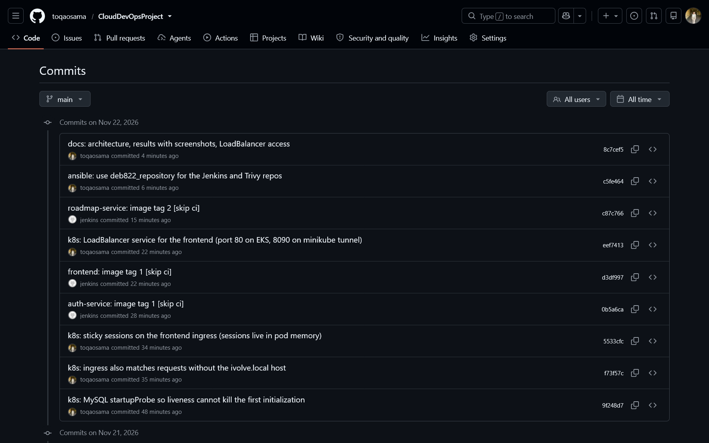

## 7. Argo CD (GitOps)

Application `ivolve-app` follows `k8s/overlays/local`, auto-sync with prune and self-heal.
It is **Synced** to the last Jenkins commit and **Healthy**:

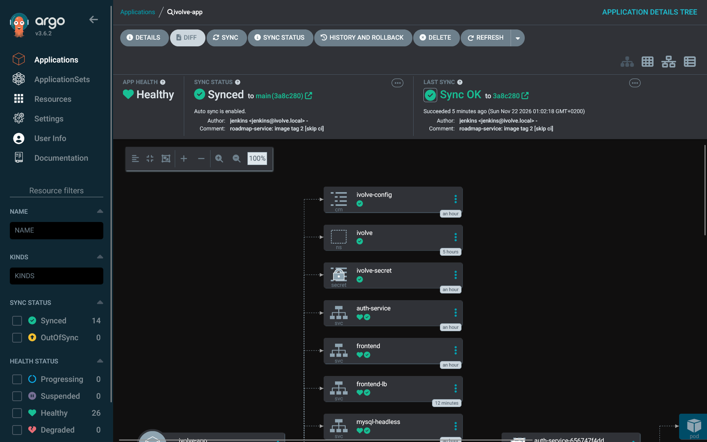

## Problems found and fixed during the runs

| Problem | Cause | Fix |
|---|---|---|
| `mysql-0` CrashLoopBackOff, InnoDB "data files are corrupt" | liveness probe killed mysqld during the first initialization | `startupProbe` (up to 5 min) before liveness; wiped the half-initialized volume |
| Roadmap page randomly redirected to login | 2 frontend replicas, sessions stored in pod memory | sticky sessions: ingress cookie affinity, `sessionAffinity: ClientIP` on the LoadBalancer |
| `Bind for 0.0.0.0:3000 failed` in compose | port 3000 already used on the host | `FRONTEND_PORT` variable in `.env` |
| roadmap pipeline: `failed to export layer` | transient Docker Desktop storage error | re-run (build #2 passed) |
